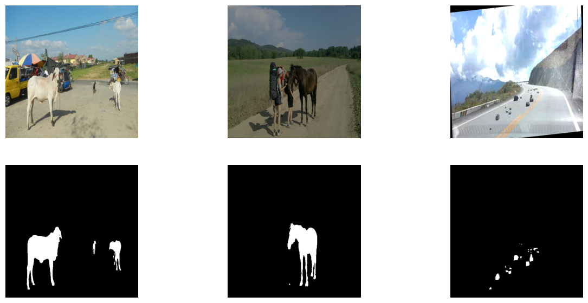
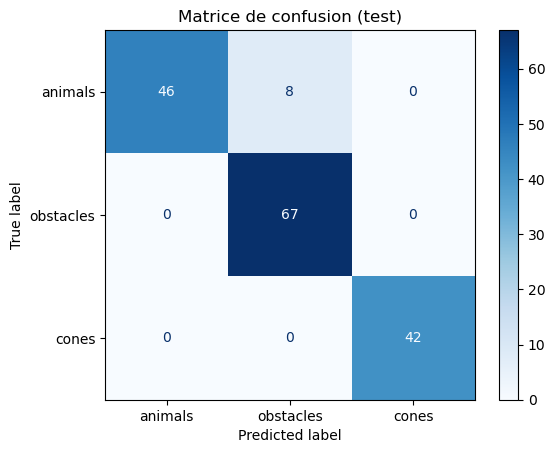
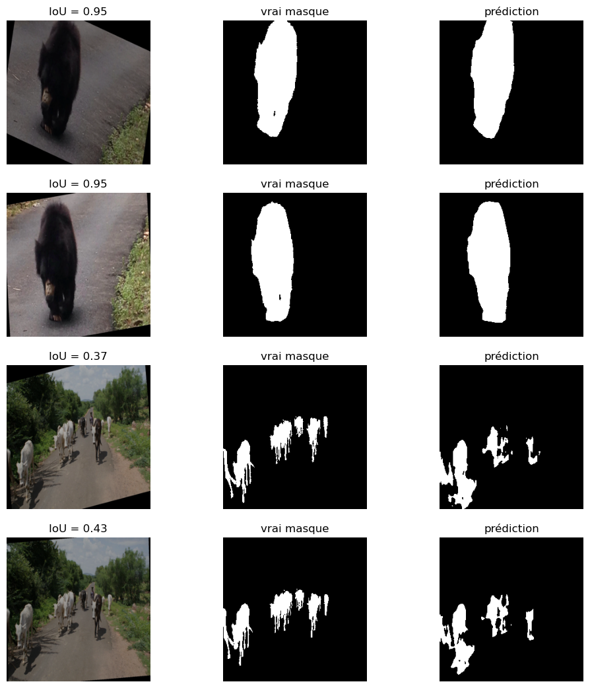
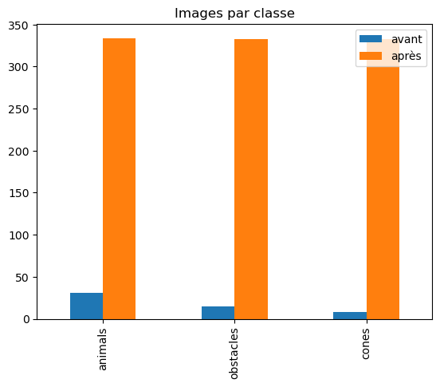
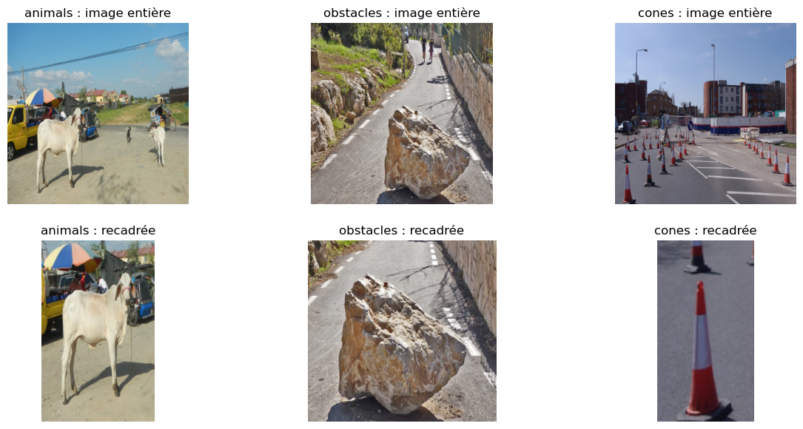

# 🚧 Détection d'anomalies routières par Deep Learning

Projet académique réalisé à **ESPRIT** (cycle ingénieur, spécialité Business Intelligence).

L'objectif est d'aider un véhicule à repérer un danger sur la route à partir d'une image, en répondant à deux questions :

- **Où est le danger ?** → **segmentation** : pour chaque pixel, anomalie (1) ou fond (0)
- **Quel est le danger ?** → **classification** : `animals`, `obstacles` ou `cones`



---

## 📊 Résultats

### Classification du type d'anomalie (3 classes, 163 images de test)

| Modèle | Accuracy test | F1 macro test |
|---|---|---|
| ResNet-50 | **96,9 %** | **0,97** |
| **EfficientNet-B0 (v2)** | 95,1 % | 0,95 |
| MobileNetV2 | 93,9 % | 0,94 |



### Segmentation (U-Net v2)

| Ensemble | IoU | Dice | AUROC | AP |
|---|---|---|---|---|
| Validation | 0,59 | 0,74 | 0,937 | 0,764 |
| Test | 0,78 | 0,88 | 0,987 | 0,943 |

Objectif fixé : **IoU ≥ 0,5 et AP ≥ 0,6** → atteint sur la validation et le test.



---

## 🔍 Démarche

### 1. Préparation des données
- Suppression des classes trop rares (`vehicle`, `tires`) → 3 classes
- **Augmentation** (rotation ±15°, luminosité), avec le masque transformé de la même façon → **1 000 images équilibrées** (334 / 333 / 333)
- Découpage **70 / 15 / 15 par photo d'origine** : une photo et ses copies augmentées ne sont jamais à la fois en train et en test, pour éviter les fuites de données
- Images en 512 × 512, masques binaires 0 / 1, normalisation ImageNet



### 2. Classification : le problème du décor
Une première version d'EfficientNet-B0 entraînée sur l'image entière avait un écart important entre validation (F1 0,85) et test (F1 0,98) : le modèle reconnaissait le **décor** de chaque photo plutôt que l'objet.

La **version 2** corrige ce problème :
- **recadrage sur l'objet** grâce au masque de segmentation
- **label smoothing** et **weight decay**
- **transfer learning en 2 temps** : tête seule, puis derniers blocs dégelés avec **early stopping** sur le F1 macro

Les mêmes réglages sont appliqués à ResNet-50 et MobileNetV2, afin de comparer les 3 modèles de manière équitable.



### 3. Segmentation
- **U-Net** avec encodeur pré-entraîné ImageNet
- Perte **Dice + Focal** pour gérer le déséquilibre des pixels (≈ 92 % de fond, 8 % d'anomalie)
- Augmentation à la volée (recadrage, retournement, couleurs), Dropout, dégel partiel de l'encodeur, early stopping sur l'IoU de validation
- Métriques : IoU, Dice, AUROC et AP au niveau pixel

---

## 📁 Structure du dépôt

```
notebooks/
├── 01_data_augmentation.ipynb        # nettoyage des classes + augmentation
├── 02_data_preparation.ipynb         # découpage train / val / test, masques
├── classification/
│   ├── efficientnet_b0.ipynb
│   ├── resnet50.ipynb
│   └── mobilenetv2.ipynb
└── segmentation/
    └── unet_v2.ipynb
images/                               # figures du README
```

## ⚙️ Lancer le projet

```bash
pip install -r requirements.txt
```

Placer le dataset **RoadAnomaly** dans le dossier du projet (`frames/` ou `RoadAnomaly/frames/`), puis exécuter les notebooks dans l'ordre : `01` → `02` → classification / segmentation.

Le dataset et les modèles entraînés (`.pt`) ne sont pas inclus dans ce dépôt à cause de leur taille.

## ⚠️ Limites
- Le dataset ne contient que **54 photos d'origine** : les 1 000 images sont des versions augmentées, et le test repose sur **9 photos d'origine**. Les scores sont donc à interpréter avec prudence.
- L'écart d'IoU entre train (0,93) et validation (0,59) montre que le U-Net apprend encore en partie par cœur.

## 🛠️ Technologies
Python · PyTorch · torchvision · segmentation-models-pytorch · timm · scikit-learn · NumPy · Pandas · Matplotlib · Pillow

## 👤 Contact
**Noursine Troudi** – Élève ingénieure en Data, Business Intelligence & IA (ESPRIT)
